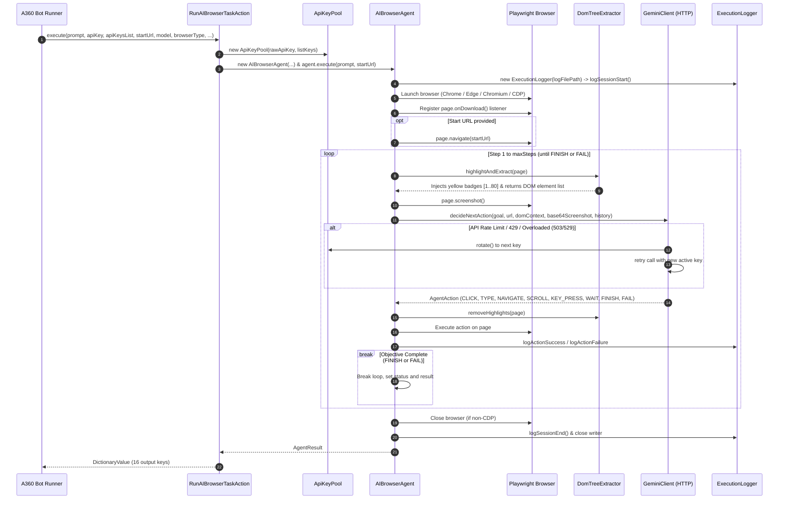

# AI Agent Guide: AI Browser Automation Package for Automation 360

This document is the primary reference manual for AI coding agents working in this repository. It provides high-density context on architecture, components, build and test requirements, runtime behaviors, and operational guardrails.

---

## 1. Project Overview & Identity

- **Name**: `AIBrowserAutomation`
- **Type**: Custom Bot Action Package for **Automation Anywhere (Automation 360 / A360)**
- **Package Group**: `com.automationanywhere.botcommand`
- **Main Action**: `Run AI Browser Task` (`runAIBrowserTask`)
- **Core Technology Stack**:
  - **Java 11** (OpenJDK / Eclipse Temurin)
  - **Playwright for Java** (`1.49.0`): Headless & headed browser engine (Chrome, MS Edge, Chromium, CDP)
  - **Google Gemini Multimodal API**: Visual reasoning and decision making (defaults to `gemini-3.8-flash`, supports `gemini-3.5-flash`, `gemini-3-flash`, `gemini-2.5-flash`, `gemini-2.0-flash`, `gemini-1.5-pro/flash`, and custom model IDs)
  - **Google Gson** (`2.10.1`): JSON payload construction, schema enforcement, and deserialization
  - **Apache Log4j2** (`2.20.0`): Enterprise logging framework
  - **Shadow Gradle Plugin** (`7.1.1`): Bundles runtime dependencies into a standalone fat JAR (`shadowJar`)

### Purpose & Differentiators
- **Zero Python/Node.js Footprint**: Bundled as a self-contained fat JAR (~193 MB). Bot Runner machines need only Java; no Python, Node.js, npm, or pip environments are required.
- **Autonomous Vision-Driven Navigation**: Instead of fragile XPath or CSS selectors, the agent analyzes the rendered page visually (via Base64 screenshots overlaid with numbered badges) and syntactically (via extracted interactive DOM element metadata).
- **Enterprise Resilience**: Includes a multi-API-key round-robin pool with automatic failover on HTTP 429/500/502/503/504 and rate limit exhaustion, headless/headed toggles, download interception directly to target directories, and real-time disk logging.

---

## 2. System Architecture & Lifecycle



---

## 3. Repository Structure & Key Files

```
ai-browser-automation-package/
├── build.gradle                  # Gradle build configuration, shadowJar setup, versioning
├── settings.gradle               # Root project name definition
├── gradle.properties             # Gradle JVM settings
├── gradlew / gradlew.bat         # Gradle wrapper scripts
├── libs/
│   ├── package-compileonly-sdk-1.6.0.jar  # A360 annotation processor & code generator
│   └── package-runtime-sdk-1.0.0.jar      # A360 runtime SDK
├── src/
│   ├── main/
│   │   ├── java/com/automationanywhere/botcommand/aibrowser/
│   │   │   ├── actions/
│   │   │   │   └── RunAIBrowserTaskAction.java  # BotCommand entry point with 12 parameters
│   │   │   ├── agent/
│   │   │   │   ├── AIBrowserAgent.java          # Core execution loop & browser coordinator
│   │   │   │   └── DomTreeExtractor.java        # Overlay injection & interactive element parsing
│   │   │   ├── gemini/
│   │   │   │   ├── ApiKeyPool.java              # Thread-safe API key pool & error classifier
│   │   │   │   └── GeminiClient.java            # HTTP client, prompt builder, schema generator
│   │   │   ├── logging/
│   │   │   │   └── ExecutionLogger.java         # Synchronous real-time file logger
│   │   │   └── model/
│   │   │       ├── AgentAction.java             # JSON action schema POJO
│   │   │       ├── AgentResult.java             # Return payload aggregator
│   │   │       └── StepRecord.java              # Detailed step telemetry record
│   │   └── resources/
│   │       ├── icons/ai-browser.svg             # Action palette icon
│   │       ├── locales/en_US.json               # Localization strings for A360 Workbench
│   │       ├── package.template                 # Package descriptor template
│   │       └── version.properties               # Auto-incremented build number counter
│   └── test/
│       └── java/com/automationanywhere/botcommand/aibrowser/
│           ├── AIBrowserPackageTest.java        # Model serialization & step formatting tests
│           ├── ApiKeyPoolTest.java              # Key rotation, error detection, delimiter parsing
│           └── ExecutionLoggerTest.java         # File logging & directory creation tests
└── .github/
    └── workflows/
        └── ci.yml                               # CI build, unit tests, and JAR verification
```

---

## 4. Component Deep Dive

### 4.1 Entry Point: `RunAIBrowserTaskAction`
- Marked with `@BotCommand` and `@CommandPkg(name = "runAIBrowserTask")`.
- Accepts **13 input parameters**:
  1. `prompt` (`TEXTAREA`, Required): The natural language objective.
  2. `apiKey` (`CREDENTIAL`, Optional*): Comma/newline-delimited keys.
  3. `apiKeysList` (`LIST`, Optional*): A360 List of Strings variable for keys.
  4. `startUrl` (`TEXT`, Optional): Initial navigation target (auto-normalizes domain names to `https://`).
  5. `model` (`SELECT`, Required): Primary Gemini model identifier (default: `gemini-3.8-flash`).
  6. `browserType` (`SELECT`, Required): `CHROME`, `MSEDGE`, `CHROMIUM`, or `CDP`.
  7. `headless` (`CHECKBOX`, Optional): Boolean flag (default `false`).
  8. `maxSteps` (`NUMBER`, Required): Loop boundary (default `15`).
  9. `cdpEndpoint` (`TEXT`, Optional): CDP WebSocket/HTTP endpoint.
  10. `logFilePath` (`TEXT`, Optional): Target path for real-time log streaming.
  11. `customModel` (`TEXT`, Optional): Custom model name override.
  12. `downloadDirectory` (`TEXT`, Optional): Target path for intercepted downloads.
  13. `fallbackModel` (`SELECT`, Optional): Fallback Gemini model when primary model encounters 503 high demand or quota exhaustion (default: `gemini-2.5-flash`).
  
  *\* At least one API key must be provided via param 2 or param 3.*

- Returns an A360 `DictionaryValue` with **18 output keys**:
  - `status`: `"SUCCESS"`, `"FAILED"`, `"ERROR"`, or `"MAX_STEPS_REACHED"`
  - `outputResult`: Extracted content, completion summary, or error message
  - `stepsLog`: Multi-line human-readable execution history
  - `stepDetailsJson`: JSON array of `StepRecord` objects with timing and status
  - `stepCount`: Number of steps executed
  - `failedStep`: Step index where failure occurred (or `0` if successful)
  - `failedAction`: Type of action that failed (`"CLICK"`, `"API_CALL"`, etc.)
  - `errorMessage`: Granular error description
  - `lastScreenshotPath`: Absolute path to the final screen capture PNG
  - `downloadedFilePath`: Path of the most recently intercepted download
  - `downloadCount`: Total number of downloaded files during the session
  - `logFilePath`: Absolute path to the generated log file
  - `activeKeyIndex`: 1-based index of the currently active Gemini API key
  - `totalKeysConfigured`: Total valid keys in the pool
  - `totalRotations`: Number of times the pool rotated keys
  - `completedStep`: Same as `stepCount` for backward compatibility
  - `activeModel`: Gemini model that executed the task (e.g. `gemini-3.8-flash` or fallback `gemini-2.5-flash`)
  - `modelFallbackOccurred`: `"true"` if primary model failed over to fallback model, else `"false"`

### 4.2 Autonomous Coordinator: `AIBrowserAgent`
- **Intelligent URL Normalization**: Automatically normalizes bare domain names (e.g. `google.com` -> `https://google.com`), loopbacks (`localhost:8080` -> `http://localhost:8080`), and file paths to avoid Playwright `Protocol error (Page.navigate): Cannot navigate to invalid URL` crashes.
- Initializes Playwright runtime and launches browser channel (`chrome`, `msedge`, or fallback to bundled `chromium`).
- Attaches an asynchronous `page.onDownload(download -> ...)` listener that captures files immediately to disk before standard navigation can discard them.
- Executes the autonomous step loop up to `maxSteps`.
- Handles step failure gracefully: if an action fails (e.g. locator timeout or navigation error), records the failure in `history` and passes the error context back to Gemini in the next step for recovery, unless the browser or page closed.

### 4.3 Visual Grounding: `DomTreeExtractor`
- Injects `HIGHLIGHT_SCRIPT` into the page to identify up to 80 interactive elements (`<a>`, `<button>`, `<input>`, `<textarea>`, `<select>`, ARIA roles).
- Pins numbered gold badges (`[1]`, `[2]`, ...) on top of elements using `position: fixed` and `z-index: 2147483647`.
- Generates a compact structural DOM summary: `[id] <tag type="..." placeholder="..." aria-label="..."> "text" </tag>`.
- Calls `removeHighlights()` immediately after screenshot capture to avoid altering user interaction or DOM structure.

### 4.4 Gemini Integration & Dual-Tier Failover: `GeminiClient` & `ApiKeyPool`
- Uses native `java.net.http.HttpClient` with a 25-second connection timeout and 60-second request timeout.
- Sends multimodal requests with a strict JSON schema (`response_mime_type: "application/json"`), enforcing typed action attributes (`type`, `elementId`, `text`, `pressEnter`, `url`, `scrollAmount`, `key`, `waitSeconds`, `description`, `result`).
- **Tier 1: Multi-Key Pool Auto-Rotation**:
  - Automatically inspects responses with `ApiKeyPool.isRotatableError(statusCode, responseBody)`.
  - Fails over instantly to the next configured key on:
    - HTTP `429` (Rate limit / Too many requests / Quota exhausted)
    - HTTP `503` (Service unavailable / High demand spikes)
    - HTTP `529` (Site overloaded)
    - HTTP `500`, `502`, `504` (Transient gateway/server errors)
    - Response bodies containing `resource_exhausted`, `quota_exceeded`, `overloaded`, `temporarily unavailable`, `high demand`, `spikes in demand`, or `unavailable`.
- **Tier 2: Autonomous Model Fallback Strategy**:
  - If a primary model (e.g. `gemini-3.8-flash`) experiences HTTP 503 capacity spikes ("This model is currently experiencing high demand") or key quota exhaustion across all configured keys, the client automatically triggers model failover to `gemini-2.5-flash` (or secondary fallback `gemini-2.0-flash`).
  - The entire key pool rotation strategy is re-applied under the fallback model.
  - Upon success, the fallback model is promoted to `activeModel` for the remainder of the session to prevent repeating 503 latency on subsequent steps.
  - Failovers are logged via `logModelFallback` and returned via `activeModel` and `modelFallbackOccurred` in the result dictionary.

### 4.5 Diagnostic Logging: `ExecutionLogger`
- Synchronous, thread-safe logger writing directly to a `BufferedWriter` with immediate line flushing (`writer.flush()`).
- Automatically creates nested parent directories if `$sLogFilePath$` points to a new path.
- Dual-outputs to Apache Log4j2 and the target disk log file.

---

## 5. Build, Environment & Testing Instructions

> [!CAUTION]
> ### Strict Java 11 Build Requirement
> The Automation Anywhere Command CodeGen SDK (`package-compileonly-sdk-1.6.0.jar`) uses an annotation processor that **strictly requires Java 11 (JDK 11)**.
> Running `./gradlew compileJava` or `./gradlew test` with **Java 17 or newer** will fail with:
> ```
> com.automationanywhere.commandsdk.processing.ProcessingException: Incorrectly typed data found for annotation element public abstract ... CommandPkg.multiple_returns()
> ```
> To compile locally or in CI, ensure `JAVA_HOME` points to a JDK 11 installation (e.g. `export JAVA_HOME=/usr/lib/jvm/temurin-11` or install OpenJDK 11).

### Essential Gradle Commands
```bash
# Run unit tests (TestNG)
./gradlew test --info

# Build package fat JAR (outputs to build/libs/AIBrowserAutomation-1.0.<build>.jar)
./gradlew shadowJar

# Clean and rebuild entire distribution
./gradlew clean shadowJar

# Inspect generated package.json inside JAR
unzip -p build/libs/AIBrowserAutomation-*.jar package.json
```

### Versioning Mechanism
- `build.gradle` reads and updates `src/main/resources/version.properties`.
- The task `incrementBuildNumber` increments `build.number` automatically on `processResources` and `shadowJar`.
- The resulting package version format is `1.0.<build_number>`.

---

## 6. Development Rules & Guardrails for Agents

1. **Preserve A360 Annotations**:
   Do not alter `@BotCommand`, `@CommandPkg`, `@Idx`, or `@Pkg` structures unless explicitly required by an action specification update. Automation Anywhere's `commandCodeGen` task uses these annotations during compilation to generate metadata and proxy wrappers.

2. **Maintain Output Dictionary Keys**:
   Bot scripts created in Automation 360 reference output dictionary keys by exact string names (e.g., `status`, `outputResult`, `downloadedFilePath`, `logFilePath`). **Never rename or delete existing return keys** in `RunAIBrowserTaskAction.execute()`. Always add new keys additively.

3. **Synchronize Action Schema**:
   If adding or changing an action type in `AgentAction.java`, you **must** update:
   - The JSON schema definition in [`GeminiClient.buildRequestBody()`](file:///home/heng/Development/play-wr/ai-browser-automation-package/src/main/java/com/automationanywhere/botcommand/aibrowser/gemini/GeminiClient.java)
   - The prompt documentation in [`GeminiClient.buildPrompt()`](file:///home/heng/Development/play-wr/ai-browser-automation-package/src/main/java/com/automationanywhere/botcommand/aibrowser/gemini/GeminiClient.java)
   - The execution dispatcher switch in [`AIBrowserAgent.execute()`](file:///home/heng/Development/play-wr/ai-browser-automation-package/src/main/java/com/automationanywhere/botcommand/aibrowser/agent/AIBrowserAgent.java)

4. **Zero External Runtime Prerequisites**:
   Keep all dependencies bundled via `shadowJar`. Avoid adding external dependencies that require system-level Python packages, Node binaries, or platform-specific CLI tools on the Bot Runner machines.

5. **Thread Safety & Key Masking**:
   Never log raw API keys to disk logs or Log4j2. Always route keys through [`ApiKeyPool.maskKey()`](file:///home/heng/Development/play-wr/ai-browser-automation-package/src/main/java/com/automationanywhere/botcommand/aibrowser/gemini/ApiKeyPool.java) before logging.
