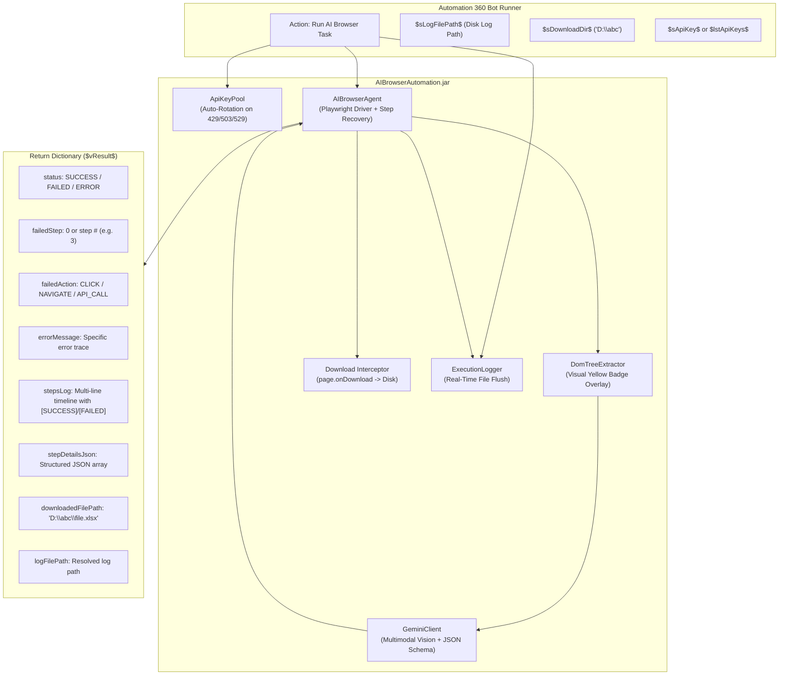

# AI Browser Automation Package for Automation Anywhere (A360)

[](https://www.automationanywhere.com/)
[](https://github.com/KongLimheng/ai-browser-automation-package/actions/workflows/ci.yml)
[](https://github.com/KongLimheng/ai-browser-automation-package/releases/latest)
[](https://adoptium.net/)
[](https://ai.google.dev/)
[](https://playwright.dev/java/)

An enterprise-grade custom package for **Automation Anywhere (Automation 360 / A360)** that enables autonomous web automation driven by natural language prompts. Powered by **Google Gemini Multimodal API** (up to **Gemini 3.8 Flash**) and **Playwright for Java**, it navigates websites, enters text, clicks buttons, solves multi-step workflows, and extracts data without requiring brittle XPath or CSS selectors.

---

## Key Features

- **Prompt-Driven Autonomy**: Simply provide an objective (e.g. *"Navigate to portal, click sidebar Reports, enter date range, select category B, submit, wait for data table, and export to Excel"*). The AI visually inspects the screen and determines every subsequent click, keystroke, scroll, and navigation step.
- **Pure Java Architecture**: Bundled as a standalone fat JAR (`shadowJar`). **No Python, node.js, or pip installations required on Bot Runner machines.**
- **Next-Gen Gemini Models**: Direct support for `gemini-3.8-flash` (recommended default), `gemini-3.5-flash`, `gemini-3-flash`, `gemini-2.5-flash`, `gemini-2.0-flash`, `gemini-1.5-pro/flash`, and custom fine-tuned model IDs.
- **Multi-API-Key Pooling with Auto-Rotation**: Provide multiple Gemini API keys via Credential Vault or List variables. Automatically fails over to healthy keys on HTTP `429` (Rate Limit / Quota Exhaustion), `503` (Unavailable), `529` (Overloaded), or transient server errors.
- **Automatic File Download Interception**: Intercepts browser file downloads at the protocol level when clicking "Export" or "Download". Saves directly to your target directory (e.g. `D:\abc` or `$sDownloadDir$`) and returns `$vResult{downloadedFilePath}$` without needing native OS "Save As" dialog handling.
- **Variable-Driven Real-Time Logging**: Stream timestamped execution logs to any file path passed from an Automation 360 variable (`$sLogFilePath$`). Parent directories are created automatically, and lines are flushed immediately to disk.
- **Granular Step Diagnostics**: Pinpoint exactly which step succeeded or errored, inspect execution durations per step, view failure screenshots, and inspect machine-readable JSON step logs.
- **Enterprise Browser Support**: Automates system Google Chrome, Microsoft Edge, bundled Chromium, or connects to an existing authenticated session via Chrome DevTools Protocol (CDP).

---

## Architecture Overview



---

## Package Deliverables & Releases

The pre-compiled, self-contained package JAR can be downloaded directly from GitHub Releases:

👉 **[Download Latest Package JAR from GitHub Releases](https://github.com/KongLimheng/ai-browser-automation-package/releases/latest)**

| Deliverable | Source / Download | Size | Description |
| :--- | :--- | :--- | :--- |
| **AIBrowserAutomation-1.0.9.jar** | [GitHub Releases](https://github.com/KongLimheng/ai-browser-automation-package/releases/latest) | ~193 MB | Standalone fat JAR ready to import directly into A360 Control Room |

> [!NOTE]
> The JAR contains all required runtime dependencies including Playwright for Java, native platform drivers, Log4j2, and Google Gson.

---

## Installation in Automation 360 Control Room

1. Log into your **Automation 360 Control Room** with an administrator or package manager account.
2. Navigate to **Manage** > **Packages** in the left-hand navigation menu.
3. Click the **Add Package** icon in the top-right corner.
4. Download and select [`AIBrowserAutomation-1.0.9.jar`](https://github.com/KongLimheng/ai-browser-automation-package/releases/latest).
5. Once uploaded, the Control Room displays:
   - **Name**: `AIBrowserAutomation`
   - **Version**: `1.0.9`
   - **Commands**: `Run AI Browser Task`
6. (Optional) Set version `1.0.9` as the default package version across the Control Room.
7. Open **Bot Creator Workbench**. In the Actions palette on the left, search for **"AI Browser Automation"** to begin using the action.

---

## Action Reference: "Run AI Browser Task"

The package provides the **Run AI Browser Task** (`runAIBrowserTask`) action.

### Input Parameters

| # | Parameter | Type | Required | Default | Description |
| :-: | :--- | :--- | :-: | :--- | :--- |
| **1** | **Natural Language Prompt / Objective** | `TEXTAREA` | **Yes** | — | High-level instructions of what the AI agent should achieve (e.g. *"Navigate to portal, click [A] sidebar menu, set dates, select dropdown B, submit, wait for table, and export"*). |
| **2** | **Gemini API Key(s)** | `CREDENTIAL` | Optional* | — | Single key or multiple keys separated by comma (`,`), semicolon (`;`), or newline (`\n`). (*At least one key must be provided via param 2 or 3). |
| **3** | **Gemini API Keys (List Variable)** | `LIST` | Optional* | — | Automation 360 `List of Strings` variable containing API keys for automatic failover pool. |
| **4** | **Start URL (Optional)** | `TEXT` | No | `""` | Initial website URL to navigate to. If left blank, the AI will decide or enter the URL itself. |
| **5** | **Gemini Model** | `SELECT` | **Yes** | `gemini-3.8-flash` | Multimodal model for visual reasoning. Options: `gemini-3.8-flash`, `gemini-3.5-flash`, `gemini-3-flash`, `gemini-2.5-flash`, `gemini-2.0-flash`, `gemini-1.5-flash`, `gemini-1.5-pro`, `CUSTOM`. |
| **6** | **Browser Type** | `SELECT` | **Yes** | `CHROME` | Browser engine: `Google Chrome`, `Microsoft Edge`, `Chromium` (bundled), or `CDP` (Connect over Chrome DevTools Protocol). |
| **7** | **Run Headless (Background)** | `CHECKBOX` | No | `false` | Uncheck to watch the browser actions live on screen. Check to run silently in the background. |
| **8** | **Max Steps Limit** | `NUMBER` | **Yes** | `15` | Maximum autonomous steps allowed per task to prevent runaway executions. |
| **9** | **CDP Endpoint URL (Advanced)** | `TEXT` | No | `""` | DevTools WebSocket/HTTP URL (e.g. `http://localhost:9222`). Only used if Browser Type is set to `CDP`. |
| **10**| **Log File Path (Optional)** | `TEXT` | No | `""` | File path to write real-time execution logs (e.g. `C:\Bots\Logs\ai.log`). Accepts variables like `$sLogFilePath$`. If omitted, a temp log file is created. |
| **11**| **Custom Gemini Model ID (Optional)** | `TEXT` | No | `""` | Enter a custom or fine-tuned model name if **Custom Model** (`CUSTOM`) is chosen in parameter 5. |
| **12**| **Download Directory (Optional)** | `TEXT` | No | `""` | Target directory to save intercepted file downloads (e.g. `D:\abc` or `C:\Bots\Downloads`). Accepts bot variables `$sDownloadDir$`. |

---

### Output Dictionary (`Dictionary<String, String>`)

The action returns a `Dictionary` variable (e.g. `$vResult$`). Assign it in the **"Assign the output to variable"** property.

| Key | Type | Description | Example Value |
| :--- | :--- | :--- | :--- |
| `status` | `String` | Overall task status: `SUCCESS`, `FAILED`, `ERROR`, or `MAX_STEPS_REACHED`. | `"SUCCESS"` |
| `outputResult` | `String` | Final answer, extracted text, or explanation returned by the AI. | `"Exported data to D:\abc\report.xlsx"` |
| `downloadedFilePath`| `String`| Full path to the file intercepted and saved on disk during export/download. | `"D:\abc\report_2026.xlsx"` |
| `downloadCount` | `String` | Total number of files downloaded during the execution. | `"1"` |
| `failedStep` | `String` | Step number where an error occurred (`"0"` if successful). | `"3"` |
| `failedAction` | `String` | Action type that failed (`""` if successful). | `"CLICK"` |
| `errorMessage` | `String` | Exact error or exception message if any step failed. | `"Timeout 5000ms waiting for locator [data-ai-id='5']"` |
| `completedStep` | `String` | Total number of steps executed before completion or failure. | `"6"` |
| `stepsLog` | `String` | Human-readable chronological timeline with execution durations and `[SUCCESS]`/`[FAILED]` markers. | *(See sample below)* |
| `stepDetailsJson` | `String` | Full machine-readable JSON array of every step detail object. | *(See sample below)* |
| `logFilePath` | `String` | Full path to the execution log file on disk. | `"C:\Bots\Logs\ai_agent.log"` |
| `lastScreenshotPath`| `String`| Absolute path to screenshot captured at completion or failure. | `"/tmp/ai_browser_shot_12345.png"` |
| `stepCount` | `String` | Count of autonomous steps executed. | `"6"` |
| `activeKeyIndex` | `String` | 1-based index of the Gemini API key active at completion. | `"1"` |
| `totalRotations` | `String` | Number of times API keys were rotated due to rate limits or errors. | `"0"` |
| `totalKeysConfigured`| `String`| Total number of unique Gemini API keys in the active pool. | `"3"` |

---

## Complex Natural Language Prompt Guide

### How the AI Agent "Thinks" & Executes

The AI browser agent operates in a **perceptual loop**:
1. It takes a screenshot and overlays yellow numbered badges `[id]` on interactive elements (inputs, links, buttons, dropdowns).
2. It sends the screenshot and DOM summary to Google Gemini.
3. Gemini selects **ONE action** to perform next (e.g. click element `[4]`, type text into element `[7]`, or scroll down).
4. Playwright executes that action, waits for the page to settle, and the loop repeats.

Because of this step-by-step nature, the secret to writing reliable complex prompts is **clear milestone structuring**, **unambiguous target descriptions**, and **explicit wait/verification instructions**.

---

### Understanding File Downloads vs. OS "Save As" Dialogs

> [!IMPORTANT]
> **Native Windows OS "Save As" Popups**:
> In manual browser usage, clicking an export button often triggers a native Windows file explorer dialog (`explorer.exe`) asking where to save the file.
> 
> In automated browsers (Playwright / Chromium / Edge / Chrome):
> - **Native OS dialogs are suppressed by the browser engine.**
> - Instead, Playwright catches the download event directly at the protocol level.
> - With this package, simply set **Download Directory** (`param 12`) to your desired folder (e.g. `D:\abc` or `$sDownloadDir$`).
> - When the AI clicks the Export button, the file is automatically intercepted, written to your folder, and returned in `$vResult{downloadedFilePath}$`!

---

### Example: Complex Enterprise Filter & Export Workflow

Here is how to structure a prompt for your exact workflow:

#### Production Prompt Template

```text
Objective: Navigate to the portal, filter report data by date range and category, and export the resulting table.

Follow these sequential steps carefully:

Phase 1: Navigation & Menu
1. Navigate to the portal URL: https://erp.company.internal/analytics/reports
2. Look at the left navigation sidebar. Find and click on the menu item labeled "[A] Menu" (or 'Sales Reports').
   - Tip: If the sidebar is collapsed or minimized, click the hamburger menu icon (three horizontal bars) at the top left first to expand it.

Phase 2: Form & Filter Input
3. Enter the Start Date:
   - Locate the input field labeled "Start Date" (or 'From Date').
   - Click the field, clear any existing text, and type: "2026-01-01".
   - If a calendar popup widget appears, press the 'Tab' or 'Enter' key to close the widget and commit the value.
4. Enter the End Date:
   - Locate the input field labeled "End Date" (or 'To Date').
   - Click the field, clear any existing text, and type: "2026-03-31".
   - Press 'Tab' or 'Enter' to commit the value.
5. Select Dropdown Value:
   - Locate the dropdown menu labeled "Category" or "Type" (which contains options like A, B, C).
   - Click on the dropdown to open the list of options.
   - Click option "[B]" (or 'Option B') from the expanded menu.

Phase 3: Submit & Dynamic Table Wait
6. Submit Query:
   - Locate and click the button labeled "Submit", "Search", or "Apply Filters".
7. Verification & Wait:
   - Crucial: Wait for the data table to populate. Ensure the loading spinner or overlay disappears.
   - Check that actual table data rows are visible on screen. Do NOT proceed to export while the table is still loading or empty.

Phase 4: Export & Completion
8. Export Data:
   - Locate and click the button labeled "Export", "Download Excel", or "Export to CSV".
   - The browser will trigger the file download automatically.
9. Finish:
   - Once the export button has been clicked and the file download has initiated, finish the task and confirm: "Report filtered by category B and exported successfully".
```

---

### Prompting Patterns for Common Web Elements

#### 1. Date Fields & Calendar Pickers
Modern portals handle dates in different ways:
- **Direct typing**: *"Click the Start Date field, select all text with Backspace, and type 'YYYY-MM-DD'."*
- **Calendar popups**: *"If a calendar picker opens, click the day '15' in the current month, or press Tab to close the popup."*
- **Format hints**: Always tell the AI the exact format expected by the site (e.g. `MM/DD/YYYY` vs `YYYY-MM-DD`).

#### 2. Dropdown Menus (Native vs. Custom React/Vue)
- **Native `<select>`**: *"Select 'Option B' from the Category dropdown."*
- **Custom `<div>` / `<span>` dropdowns**: *"First click the dropdown box to expand the options list. Then inspect the screen and click option 'B'."*

#### 3. Dynamic Tables & Spinners
Web apps load table data asynchronously via AJAX:
- *"Click Submit. Wait 3 seconds for the loading overlay to vanish. Verify that the table header and at least one row of records are visible before clicking Export."*

#### 4. Handling Modal Popups or Cookie Banners
Websites often present initial modal dialogs:
- *"If a cookie consent banner or 'Welcome' modal appears, click 'Accept All' or the 'X' close button before proceeding with navigation."*

---

### Using Automation 360 Variables Inside the Prompt

In Automation 360 Bot Creator, you can interpolate bot variables directly into the prompt text:

```text
Navigate to $sPortalUrl$, click sidebar menu $sMenuName$. In the Start Date field, enter "$dStartDate$". In the End Date field, enter "$dEndDate$". In the Category dropdown, select "$sCategory$". Click Submit, wait for the table rows to appear, and click Export.
```

When the bot runs, Automation 360 replaces `$sPortalUrl$`, `$dStartDate$`, and `$sCategory$` with their live runtime values!

---

## Step Success & Error Diagnostics

When a bot runs, how can you know **which step succeeded or failed**?

### 1. Simple Bot Condition
Use `$vResult{failedStep}$`:
```text
If $vResult{failedStep}$ = "0"
    // All steps succeeded!
    Log to File: "Success: " + $vResult{outputResult}$
    Log to File: "Downloaded File: " + $vResult{downloadedFilePath}$
Else
    // Step failed!
    Log to File: "FAILED on Step #" + $vResult{failedStep}$ + " during action [" + $vResult{failedAction}$ + "]"
    Log to File: "Reason: " + $vResult{errorMessage}$
    Open File: $vResult{lastScreenshotPath}$
End If
```

### 2. Human-Readable `stepsLog`
`$vResult{stepsLog}$` provides a formatted timeline with per-step durations and status tags:
```text
Step 1 [SUCCESS] (1250 ms): [NAVIGATE] Opened https://erp.company.internal/reports
Step 2 [SUCCESS] (820 ms):  [CLICK] Clicked sidebar menu '[A] Menu' [data-ai-id='4']
Step 3 [SUCCESS] (910 ms):  [TYPE] Entered '2026-01-01' into Start Date [data-ai-id='12']
Step 4 [SUCCESS] (780 ms):  [TYPE] Entered '2026-03-31' into End Date [data-ai-id='14']
Step 5 [SUCCESS] (650 ms):  [CLICK] Selected 'Option B' from dropdown [data-ai-id='18']
Step 6 [SUCCESS] (1420 ms): [CLICK] Clicked Submit button [data-ai-id='22']
Step 7 [SUCCESS] (2000 ms): [WAIT] Waited for table data to settle
Step 8 [SUCCESS] (510 ms):  [CLICK] Clicked Export button [data-ai-id='29']
Step 9 [SUCCESS] (320 ms):  [FINISH] Report filtered and exported successfully
```

### 3. Machine-Readable `stepDetailsJson`
`$vResult{stepDetailsJson}$` contains a structured JSON array for advanced parsing:
```json
[
  {
    "stepNumber": 1,
    "actionType": "NAVIGATE",
    "description": "Opened https://erp.company.internal/reports",
    "status": "SUCCESS",
    "targetUrl": "https://erp.company.internal/reports",
    "durationMs": 1250,
    "timestamp": "2026-10-21T15:35:10.120Z"
  },
  {
    "stepNumber": 2,
    "actionType": "CLICK",
    "description": "Clicked sidebar menu [A]",
    "status": "SUCCESS",
    "elementId": 4,
    "durationMs": 820,
    "timestamp": "2026-10-21T15:35:11.450Z"
  }
]
```

---

## Complete Automation 360 Export Bot Pattern

Here is the recommended configuration in Bot Creator for your workflow:

```text
// 1. Define Variables
String $sPortalUrl$ = "https://erp.company.internal/reports"
String $sDownloadFolder$ = "D:\abc"
String $sLogFile$ = "C:\Bots\Logs\report_export.log"
Dictionary $vResult$

// 2. Execute AI Browser Automation
AI Browser Automation: Run AI Browser Task
    Prompt: "Navigate to " + $sPortalUrl$ + ", click [A] menu in sidebar, input start date '2026-01-01' and end date '2026-03-31', select dropdown value 'b', click submit, wait for table data to load, and click export."
    Gemini API Key(s): Credential($sGeminiVaultKey$)
    Gemini Model: gemini-3.8-flash
    Browser Type: Google Chrome
    Headless: false  // watch live or set to true for unattended
    Max Steps: 20
    Log File Path: $sLogFile$
    Download Directory: $sDownloadFolder$
    Assign Output: $vResult$

// 3. Process Result
If $vResult{status}$ = "SUCCESS"
    Message Box: "Report exported successfully to: " + $vResult{downloadedFilePath}$
    // Pass $vResult{downloadedFilePath}$ directly to Excel Advanced or Email actions!
Else
    Log to File: "Export failed on Step " + $vResult{failedStep}$ + ": " + $vResult{errorMessage}$
    Email: Send Email (attach $vResult{lastScreenshotPath}$)
End If
```

---

## Multi-API-Key Pooling & Auto-Failover

Enterprise RPA tasks often encounter rate limits (`RESOURCE_EXHAUSTED` / HTTP 429) during peak traffic. The package solves this with automatic key rotation.

### How to Configure Multiple Keys

1. **Delimited Text in Credential Vault (`apiKey`)**:
   Enter comma-, semicolon-, or newline-separated keys into your Credential Locker attribute:
   ```text
   AIzaSyKeyOne, AIzaSyKeyTwo, AIzaSyKeyThree
   ```
2. **Automation 360 List Variable (`apiKeysList`)**:
   Create a `List of Strings` variable `$lstGeminiKeys$` and pass it into the **Gemini API Keys (List Variable)** field.

### Failover Trigger Conditions
The pool immediately switches to the next healthy key upon encountering:
- **HTTP 429**: Too Many Requests / `RESOURCE_EXHAUSTED`.
- **HTTP 503**: `UNAVAILABLE`.
- **HTTP 529**: `SITE_OVERLOADED`.
- **HTTP 500 / 502 / 504**: Transient server errors.
- JSON error responses containing `"quota"`, `"limit"`, or `"exhausted"`.

> [!TIP]
> **Credential Security**: All API keys are masked in log files and console output (e.g. `AIzaSy...9xyz`), ensuring enterprise audit compliance.

---

## Building from Source

### Prerequisites
- **JDK 11**: Build requires Java 11 (e.g. Eclipse Temurin OpenJDK 11).
  ```bash
  export JAVA_HOME=/home/heng/.jdks/jdk-11.0.32.1+1
  ```

### Build Commands
```bash
# Navigate to package directory
cd ai-browser-automation-package

# Run unit tests
JAVA_HOME=/home/heng/.jdks/jdk-11.0.32.1+1 ./gradlew clean test

# Build complete fat JAR
JAVA_HOME=/home/heng/.jdks/jdk-11.0.32.1+1 ./gradlew shadowJar
```

The compiled package will be generated at:
```
build/libs/AIBrowserAutomation-1.0.9.jar
```

---

## Troubleshooting & FAQs

### Q1: Will a native Windows "Save As" file popup appear when clicking Export?
**Answer**: No. Automated browser engines (Playwright, Puppeteer, Selenium) suppress native OS dialogs. Instead, the package intercepts the download event automatically at the network layer and saves the file directly into your **Download Directory** (`param 12`), returning the final file path in `$vResult{downloadedFilePath}$`.

### Q2: How do I make sure the AI waits for slow tables before clicking Export?
**Answer**: In your prompt, explicitly state: *"Wait for the loading spinner to disappear and verify that the table has populated with data rows before clicking Export."* You can also increase **Max Steps Limit** (e.g. 20–25).

### Q3: What happens if a dropdown uses custom `<div>` elements instead of `<select>`?
**Answer**: Gemini natively handles custom JavaScript/React/Angular dropdowns. In the prompt, state: *"Click the dropdown box to expand the menu, then click option 'B'."*

---

## CI/CD Pipeline & Automated Releases

The repository includes pre-configured **GitHub Actions** workflows:

### 1. Continuous Integration (`ci.yml`)
- Automatically runs on every `push` and `pull_request` to `main`.
- Sets up Eclipse Temurin JDK 11 and caches Gradle dependencies.
- Runs the test suite (`./gradlew clean test --info`).
- Compiles the fat JAR (`./gradlew shadowJar`) and verifies `package.json` command registration.

### 2. Automated Releases (`release.yml`)
To trigger an automated build and release:
```bash
# 1. Tag your commit
git tag v1.1.0

# 2. Push tag to GitHub
git push origin v1.1.0
```
GitHub Actions will automatically:
1. Spin up an Ubuntu runner.
2. Compile and package the fat JAR.
3. Create the GitHub Release matching the tag.
4. Upload `AIBrowserAutomation-*.jar` directly as a downloadable release asset.
5. Generate release notes from git commits.

---

## License

Developed for enterprise automation with Automation Anywhere (Automation 360). Distributed under the Apache 2.0 License.
